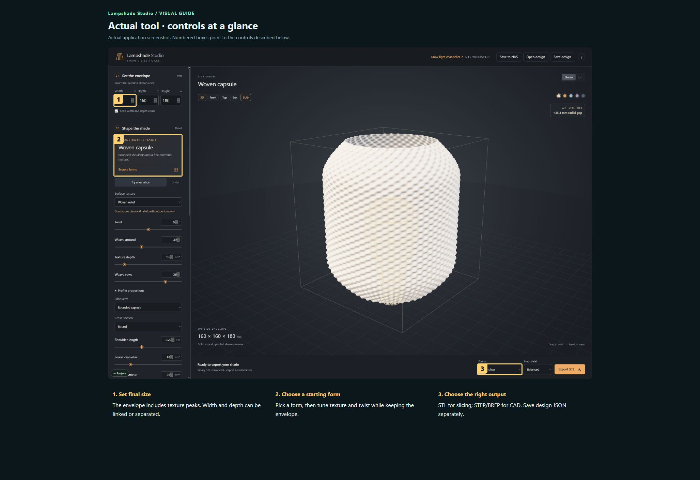
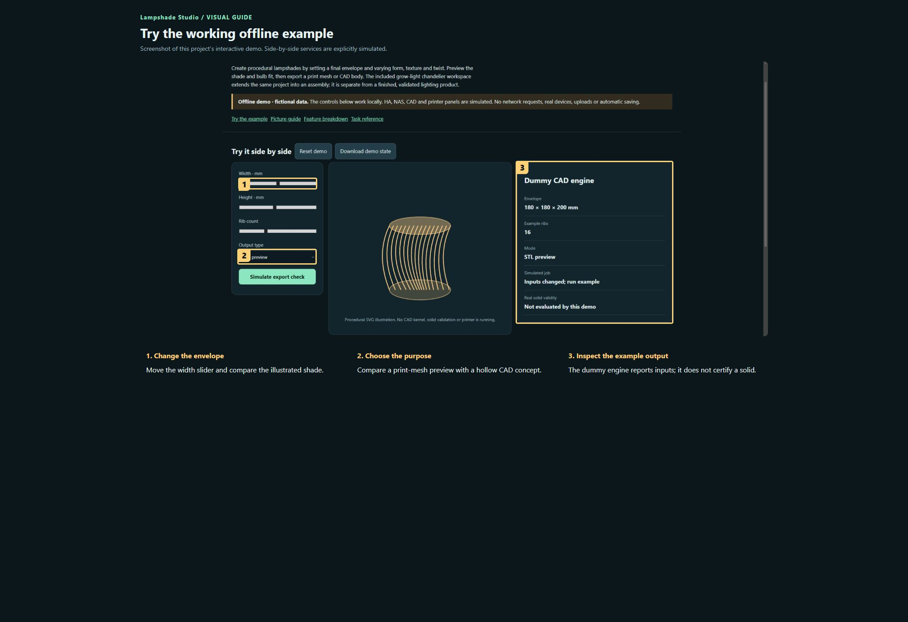

# Lampshade Studio

**Maintaining this project? [Start here](docs/START-HERE.md) · [Detailed handover](docs/HANDOVER.md)**

Create procedural lampshades by setting a final envelope and varying form, texture and twist. Preview the shade and bulb fit, then export a print mesh or CAD body. The included grow-light chandelier workspace extends the same project into an assembly; it is separate from a finished, validated lighting product.

**Private preview · not published.**

[Open the visual manual](docs/USER-MANUAL.md) · [Download the self-contained demo](demo.html) · [Release notes](CHANGELOG.md)

Download `demo.html` using GitHub’s Download raw file control, then open it in your browser. GitHub displays HTML source; it does not run the demo on this page. The demo is an offline simulation with fictional data and makes no network requests.

## See it

### Actual tool · controls at a glance

Actual application screenshot. Numbered boxes point to the controls described below.

1. **Set final size.** The envelope includes texture peaks. Width and depth can be linked or separated.
2. **Choose a starting form.** Pick a form, then tune texture and twist while keeping the envelope.
3. **Choose the right output.** STL for slicing; STEP/BREP for CAD. Save design JSON separately.

### Try the working offline example

Screenshot of this project’s interactive demo. Side-by-side services are explicitly simulated.

1. **Change the envelope.** Move the width slider and compare the illustrated shade.
2. **Choose the purpose.** Compare a print-mesh preview with a hollow CAD concept.
3. **Inspect the example output.** The dummy engine reports inputs; it does not certify a solid.

## What this tool does

| Feature | What it lets you do | Where |
| --- | --- | --- |
| Envelope | Final outside width, depth and height in mm; unlink width/depth for an oval. | Design and export |
| Form library | Eleven forms with ribs/folds, woven relief, smooth and triangular-facet texture choices. | Design and export |
| Profile controls | Silhouette, cross-section, belly/waist and twist vary proportions inside the envelope. | Design and export |
| Bulb reference | Dimensioned E27 bulb guides, orientation and radial clearance preview. | Design and export |
| Geometry modes | Hollow material body for CAD, or filled outer envelope for vase slicing. | Design and export |
| Export formats | STL, STEP and OpenCascade BREP; Parasolid requires a compatible licensed local NX installation. | Design and export |
| Design persistence | Save/Open JSON, hosted NAS drafts and separate chandelier design controls. | Design and export |

## A first useful workflow

### Design a shade to a fixed size

1. Set Width, Depth and Height first; these describe the final outside dimensions including texture peaks. Unlink width/depth for an oval.
2. Browse forms and select a starting style. Changing the style preserves the envelope rather than silently changing the final size.
3. Adjust texture, twist and profile. Values marked mm* are source-profile proportions before fitting, not necessarily final rim diameters.
4. Orbit the model, compare Front and Top and inspect the box and bulb guides. A radial fit check is not a heat rating or a complete holder-fit check.

## Saving and outputs

JSON preserves the generator parameters. Mesh and CAD exports are separate deliverables. The hosted edition saves a shared NAS draft; the local edition uses explicit Save design. Keep model exports and their matching design version together.

## Running the actual tool

Use the original local launcher or the authenticated hosted Lampshade Studio.

The demo has no prerequisites; the real tool may need the services described in the manual and retained source notes.

## Current boundaries

CAD validity and dimensions do not certify a physical print, mounting system or thermal safety. No new physical print or heat test was performed. Third-party reference designs and libraries retain their own rights.

## Licence and sharing

MIT applies to original project contributions. Bundled/upstream software and assets retain their own terms; see [third-party notes](THIRD-PARTY.md). Keep this repository private until its own [release checklist](RELEASE-CHECKLIST.md) is complete and the owner authorises publication.
